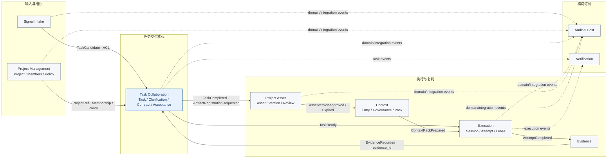
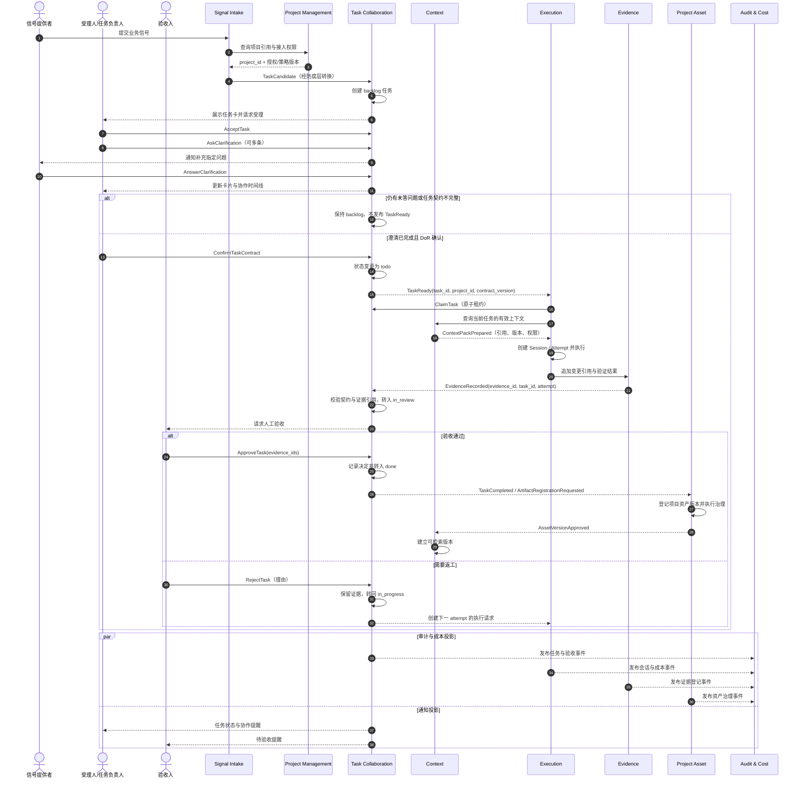

# Tandem（协动）人机协同研发平台技术设计（DDD）

> 版本：v1.1｜日期：2026-10-22｜状态：评审稿
>
> 本文是唯一技术设计文档。产品目标、范围和路线见《01-产品方案》；本文件不重复产品决策，只定义领域模型、边界、接口、数据所有权和实现约束。

## 1. 设计基线

项目是组织和访问边界，任务是唯一工作权威单元；项目管理上下文拥有项目身份、成员和策略，任务协同上下文拥有任务状态、契约和验收决定。会话是任务的执行投影；上下文是独立的一等服务；产物是项目资产的供给链；事件是审计和集成证据。所有跨服务操作必须可重试、可审计，并可按 `tenant_id/project_id/task_id` 归因。

平台不变量：未完成澄清或 DoR 的任务不能进入执行队列；同一任务同一时刻只能有一个有效租约；Agent 最多把任务推进到 `in_review`，`done` 只能由授权人员确认；未经来源、权限、版本、有效期和质量治理的产物不能自动成为可信上下文；Taskboard 是任务状态和评论的权威源。

## 2. 领域划分与限界上下文

### 2.1 核心域：Task Collaboration（任务协同）

负责项目内任务的受理、澄清、契约、状态、责任、验收和返工。该上下文拥有 `Task` 聚合及其业务规则；`Project` 是独立的项目管理上下文，向任务协同提供项目身份、成员授权和策略快照，不与任务聚合共享事务。

### 2.2 支撑域

| 限界上下文 | 责任 | 权威对象 |
|---|---|---|
| Signal Intake | 接收业务/IM/Git 信号，形成待受理任务 | Signal |
| Project Management | 项目身份、成员、项目策略和资产导航 | Project |
| Execution | 创建会话、执行工具、管理租约和 attempt | ExecutionSession / Lease |
| Context | 提议、治理、检索和注入项目上下文 | ContextEntry / ContextPack |
| Project Asset | 登记任务产物、版本、来源、权限和索引 | ProjectAsset / Artifact |
| Audit & Cost | 归一化审计、trace 和成本记录 | AuditEvent / CostRecord |
| Identity & Governance | 身份、租户、角色、治理策略和限额 | Tenant / Policy |

### 2.3 通用域

通知、搜索、指标和文件存储属于通用能力，通过领域事件与核心域解耦，不反向拥有任务状态。

## 3. 上下文映射

上下文按输入与组织、任务交付核心、执行与复利分区。图中实线箭头表示命令/API 或事件传递，虚线表示只读订阅；核心上下文各自拥有事实，不共享内部表。



Project Management 提供项目身份和授权事实，Task Collaboration 是任务工作事实的权威上下文。Audit & Cost 与 Notification 只构建查询/通知投影，不反向拥有或修改任务状态。

### 3.1 核心协作时序

下图展示一次任务从不完整信号到项目资产沉淀的主要交互。澄清未完成时 Task 保持 `backlog`；任务契约和 DoR 确认后才进入执行。图中每个上下文只写入自己的聚合，跨上下文通过 ID、事件和明确查询协作。



**时序约束**：`TaskReady` 只由 Task Collaboration 在澄清和 DoR 均满足后发布；租约由 Execution 原子取得；证据先追加再由 Task 校验引用；只有验收人可执行 `ApproveTask`；资产审核通过后，Context 才能检索该版本。

## 4. 核心域模型

### 4.1 聚合与一致性边界

```text
Project Management BC                 Task Collaboration BC
┌──────────────────────┐              ┌──────────────────────────┐
│ Project 聚合         │  ProjectRef  │ Task 聚合                │
│ - 成员与角色         ├─────────────>│ - 状态 / 责任人          │
│ - 项目策略           │  策略快照    │ - Clarification[]        │
│ - 项目元数据         │              │ - TaskContract           │
└──────────────────────┘              │ - Comments / Acceptance  │
                                       └────────────┬─────────────┘
                                                    │ task_id / event
                          ┌─────────────────────────┼──────────────────────┐
                          v                         v                      v
                 Execution Session             Project Asset             Context
                 attempt / lease / evidence     artifact/version          entry/version
```

| 聚合 | 聚合根与内部对象 | 一致性不变量 | 明确不拥有 |
|---|---|---|---|
| Project | `Project`；成员、角色、治理策略 | 成员变更和项目策略版本在项目边界内一致 | 任务状态、任务评论、会话、资产内容 |
| Task | `Task`；澄清项、任务契约、评论、验收决定引用 | 单任务的受理、澄清、DoR、状态和验收决定原子校验 | 执行租约、会话事件、完整产物正文、项目成员目录 |
| Execution Session | `ExecutionSession`；attempt 序号、租约、执行阶段 | 一个 Session 对应一个 attempt；有效租约由条件写入保证；会话终态不可回退 | Task 权威状态、人工验收决定 |
| Evidence | `EvidenceRecord`；变更引用、验证结果、摘要 | 证据按 attempt 追加且不可覆盖，修订生成新记录；Task 以 ID 引用验收结论 | 验收规则本身 |
| Project Asset | `ProjectAsset`；资产元数据、版本、审核记录 | 每个版本归属项目并关联来源任务；审核针对特定版本 | Task 状态、上下文注入策略 |
| Context Entry | `ContextEntry`；版本、质量信号、有效期 | 只有获批且有效的版本可被检索为可信上下文 | 项目任务和任务状态 |

`Task` 与 `Project` 以 ID 关联，不把项目下所有任务嵌进 Project 聚合。评论若仅服务协作时间线，可作为 Task 子实体；大体量审计日志单独存储并由 `task_id` 关联。执行、证据、资产、上下文各自独立事务，通过命令/事件推进 Task，不跨聚合直接写表。

### 4.2 实体与值对象

实体拥有可持续识别的身份和值对象描述无独立身份的属性或规则：

| 所属上下文 | 实体 | 主要值对象 | 说明 |
|---|---|---|---|
| Project Management | `Project` | `ProjectId`、`GovernancePolicy` | 项目身份、成员和策略版本 |
| Task Collaboration | `Task`、`Clarification` | `TaskId`、`TaskStatus`、`TaskContract`、`AcceptanceCriterion` | 任务契约与澄清项由 Task 聚合管理 |
| Execution | `ExecutionSession` | `SessionId`、`LeaseWindow` | 会话对应一次执行 attempt |
| Execution（Evidence 聚合） | `EvidenceRecord` | `EvidenceId`、`EvidenceRef` | 验证结果和交付引用按 attempt 追加 |
| Project Asset | `ProjectAsset` | `AssetId`、`AssetVersionId` | 项目资产及其审核版本 |
| Context | `ContextEntry` | `QualityLabel`、有效期 | 经治理后可供任务检索的上下文条目 |

标识类型（如 `ProjectId`、`TaskId`、`ClarificationId`、`SessionId`、`AttemptId`、`EvidenceId`、`AssetId`、`AssetVersionId`）是值对象，不是实体。`TaskContract` 至少描述目标、范围、验收标准、责任人和执行约束；具体字段可由项目策略扩展，不预置业务规则。

### 4.3 任务状态机

| 当前状态 | 允许的后续状态 | 业务条件 |
|---|---|---|
| `backlog` | `todo`、`canceled` | 澄清完成且任务契约通过 DoR 后才可进入 `todo` |
| `todo` | `in_progress`、`canceled` | Execution 成功取得任务租约后开始执行 |
| `in_progress` | `in_review`、`blocked`、`canceled` | 提交证据后可申请验收；遇到阻碍可转 `blocked` |
| `in_review` | `done`、`in_progress`、`canceled` | 授权验收人通过；或填写返工理由退回 |
| `blocked` | `in_progress`、`canceled` | 阻碍解除后恢复执行 |
| `done` | `in_progress`、`todo`、`canceled` | 重新打开保留原验收与执行历史 |
| `canceled` | `todo` | 重新打开回到待办流程 |

`backlog` 在信息不足时保持原位。Agent 不能调用 `ApproveTask`，因此不能自行将任务置为 `done`。

## 5. 聚合命令与领域事件

### 按聚合分组的命令

| 聚合/上下文 | 命令 | 责任边界 |
|---|---|---|
| Project | `CreateProject`、`ChangeMembership`、`ChangeProjectPolicy` | 项目身份、成员和项目策略 |
| Task | `CreateTaskFromSignal`、`AcceptTask`、`AskClarification`、`AnswerClarification`、`ConfirmTaskContract`、`SubmitForReview`、`ApproveTask`、`RejectTask` | 任务生命周期与人工验收决定 |
| Execution | `ClaimTask`、`StartAttempt`、`CompleteAttempt` | 原子认领和执行会话生命周期 |
| Execution（Evidence 聚合） | `RecordEvidence` | 按 attempt 追加执行证据 |
| Project Asset | `RegisterProjectAsset`、`ApproveAssetVersion` | 项目资产登记与版本审核 |
| Context | `ApproveContextProposal` | 上下文提议治理 |

应用服务可以编排多个命令，但每个聚合只在自身边界内校验和提交。验收前先校验指定的 `EvidenceRecord`；随后由 Task 聚合记录验收决定及证据 ID，不复制证据正文。

### 领域事件

| 来源聚合/上下文 | 事件 | 订阅方用途 |
|---|---|---|
| Project | `ProjectCreated`、`MembershipChanged` | 更新项目目录与授权投影 |
| Task | `TaskCreated`、`TaskAccepted`、`ClarificationRequested`、`ClarificationAnswered`、`TaskReady`、`TaskSubmittedForReview`、`TaskApproved`、`TaskRejected` | 驱动任务面板、调度、验收通知和审计投影 |
| Execution | `TaskClaimed`、`AttemptStarted`、`AttemptCompleted` | 更新任务时间线、执行监控和审计 |
| Execution（Evidence 聚合） | `EvidenceRecorded` | 供任务验收和审计引用 |
| Project Asset | `AssetVersionRegistered`、`AssetVersionApproved` | 更新项目资产列表并通知 Context |
| Context | `ContextPackPrepared` | 记录上下文引用并供 Execution 注入 |

领域事件由所属聚合产生；面向其他上下文发布的集成事件由应用层映射并版本化。

### 事件信封与投递

每个事件包含以下公共字段：

| 字段 | 含义 |
|---|---|
| `event_id` | 全局唯一事件标识，用于去重 |
| `aggregate_id` | 产生事件的聚合标识 |
| `tenant_id`、`project_id`、`task_id` | 租户、项目和任务归因；不适用的关联可为空 |
| `actor` | 触发动作的人、Agent 或系统身份 |
| `occurred_at` | 业务事件发生时间 |
| `trace_id` | 跨服务调用追踪标识 |
| `idempotency_key` | 命令或回调幂等键 |
| `payload_version` | 事件载荷版本 |

事件通过 outbox 发布，消费者按 `event_id` 去重；Webhook 失败通过轮询或重放补偿。

## 6. 应用层与服务架构

```text
信号/IM/Git → Signal Intake → Task Collaboration（Taskboard 权威源）
                                      │ commands/events
                    ┌─────────────────┼─────────────────┐
                Execution          Context          Project Asset
                ACP / Attempt / Lease  Entry / Pack  Asset / Version / Review
                    └─────────────────┴─────────────────┘
                          Audit & Cost / Notification
                                  │
                         Identity / Governance / Gateway
```

接入层不保存任务主数据；调度器只保存跨系统映射、租约和幂等键；Context 和 Project Asset 分别拥有自己的元数据；审计服务保存归一化事件。

## 7. 关键应用流程

| 阶段 | 发起方 / 命令 | 聚合处理 | 结果与约束 |
|---|---|---|---|
| 信号建卡 | Signal Intake → `CreateTaskFromSignal` | Task Collaboration 创建任务 | 建立项目内 `backlog` 任务 |
| 受理与澄清 | 受理人 → `AcceptTask`、`AskClarification`、`AnswerClarification` | Task 聚合记录受理决定和逐条澄清 | 有未答问题时保持 `backlog` |
| 契约就绪 | 负责人 → `ConfirmTaskContract` | Task 聚合校验澄清与 DoR | 满足准入后发布 `TaskReady`，进入 `todo` |
| 认领与准备 | Scheduler → `ClaimTask` | Execution 原子取得 lease；Context 查询任务级 `ContextPack` | 创建 ACP Session / Attempt；记录 `TaskClaimed`、`AttemptStarted` |
| 执行与提交 | Agent 执行，Execution 回传结果 | Evidence 聚合追加验证结果和变更引用；Task 校验证据引用 | 证据满足任务契约后进入 `in_review` |
| 人工验收 | 验收人 → `ApproveTask` 或 `RejectTask` | Task 聚合记录决定及 Evidence ID | 通过进入 `done`；打回回到 `in_progress` 并创建新 attempt，旧证据只读保留 |

### 7.1 项目资产与上下文复用

任务完成后，可通过 `RegisterProjectAsset` 将产物登记到所属项目。资产记录来源任务、版本、权限、摘要和审核状态；Context 只检索通过治理且仍有效的版本。引用命中、团队采纳、验收和打回作为质量信号；资产删除或过期时，旧引用失效并留下审计记录。

## 8. 数据模型与持久化

以下为按限界上下文分组的持久化映射示意。表的物理拆分不改变聚合边界：`clarification`、`task_acceptance` 是 Task 聚合内部记录；执行会话、证据、项目资产和上下文分别属于独立聚合。

```sql
-- Project Management
project(id, tenant_id, name, policy_json, version, created_at)
project_member(project_id, member_id, role, version)

-- Task Collaboration
task(id, tenant_id, project_id, status, title, contract_json,
     accepted_at, dor_ready, assignee_id, version, created_at, updated_at)
clarification(id, task_id, question, answer, asked_by, answered_by, status)
task_acceptance(id, task_id, decision, reviewer_id, reason, evidence_ids, decided_at)

-- Execution
execution_session(id, task_id, attempt, agent_type, status,
                  lease_owner, lease_until, started_at, ended_at, version)
evidence(id, task_id, session_id, attempt, kind, uri, digest,
         verification_status, produced_at)

-- Project Asset
project_asset(id, tenant_id, project_id, source_task_id, version,
              review_status, sensitivity, uri, digest, index_status, created_at)

-- Context
context_entry(id, tenant_id, project_id, layer, status, version,
              source_ref, quality_label, expires_at, approved_by)

-- Audit projection
audit_event(id, tenant_id, project_id, task_id, actor_type, action,
            payload_json, occurred_at, idempotency_key)
```

`task_acceptance.evidence_ids` 保存被验收的证据 ID，不复制证据正文；`project_asset.source_task_id`、`evidence.task_id` 是跨聚合引用。生产实现可按数据量拆分评论、澄清或证据表，但须保持所属聚合与写入规则。事务只在聚合边界内保证强一致，跨上下文采用事件最终一致；写模型使用版本号或条件更新，冲突返回 409。查询投影可按项目、状态、负责人、来源任务和时间组织。

## 9. 接口与权限

### 9.1 核心接口

| 能力 | 接口 | 所属上下文 |
|---|---|---|
| 接收外部信号 | `POST /intake/signals` | Signal Intake |
| 创建项目任务 | `POST /projects/{id}/tasks` | Task Collaboration |
| 记录澄清 | `POST /tasks/{id}/clarifications` | Task Collaboration |
| 确认任务就绪 | `POST /tasks/{id}/ready` | Task Collaboration |
| 请求任务执行 | `POST /tasks/{id}/dispatch` | Task Collaboration / Execution Adapter |
| 原子认领任务 | `POST /leases/claim` | Execution |
| 回写会话结果 | `POST /sessions/{id}/callback` | Execution |
| 提交验收决定 | `POST /tasks/{id}/approve` | Task Collaboration |
| 登记项目资产 | `POST /projects/{id}/assets` | Project Asset |
| 查询任务上下文 | `GET /context/query?task_id=` | Context |

接口以资源和命令为边界，命令路由到所属聚合；不暴露跨上下文表更新。

### 9.2 权限与治理

| 身份 | 允许操作 |
|---|---|
| 受理人 | 受理信号、提出和回复澄清 |
| 任务负责人 | 确认任务契约、发起执行 |
| Agent | 写入执行事件与证据、提交审核；不能确认完成 |
| 验收人 | 通过或打回任务，并记录验收依据 |
| 项目/平台管理员 | 管理项目成员与治理策略 |

权限同时受租户、项目成员关系、任务角色和具体动作限制。关键操作写入审计。生产发布方式、预算上限和代码变更方式由项目治理策略配置，不作为业务场景硬编码。

## 10. 可靠性、安全与可观测性

SSO/OIDC 位于 UI/API 前；Agent 使用短期 token、仓库白名单和最小工具权限。租约心跳、超时释放和幂等回写保证重复派发可检测。Context 查询失败时，低风险任务可使用稳定层最小包并记录降级，高风险任务转 `blocked`。成本按 `tenant_id/project_id/task_id/attempt/model` 归因；LiteLLM/Langfuse 可作为实现组件，但不改变领域边界。

目标：状态写入和审计事件幂等率 100%，事件最终一致 P95 < 60s；关键告警包括租约堆积、回写失败、治理限额触发、上下文命中率异常、审计延迟和越权拒绝。

## 11. 实施与验证

Phase 0 验证聚合命令、状态门、澄清门、权限矩阵、Webhook、ACP 会话、Context 检索、资产索引和成本记录。Phase 1 验证重复派发、服务重启、Webhook 丢失、Agent 超时、验证失败、上下文污染和治理策略触发。每个场景都必须能从 `task_id` 追溯任务、attempt、证据、资产、上下文引用和审计事件。

## 12. 参考实现边界

可借鉴 `ks-clawmate` 的 agent-center、knowledge-service、runtime-conductor 接口思想；Tandem 保持 Task Collaboration 的任务权威源、人工验收门和任务级上下文拉取边界，不直接复制参考项目的服务状态作为第二任务源。
