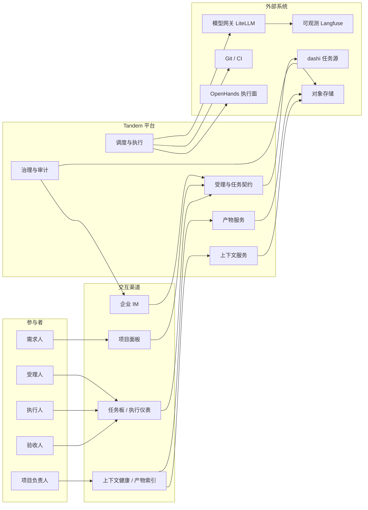
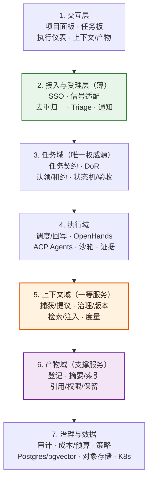
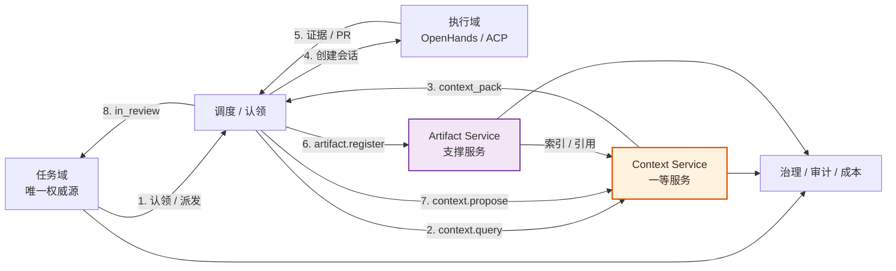
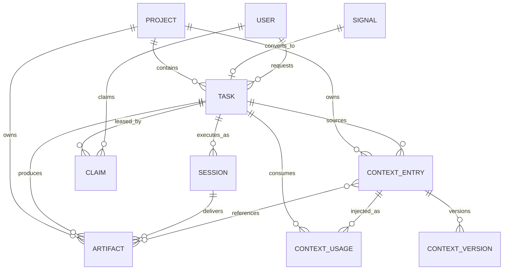
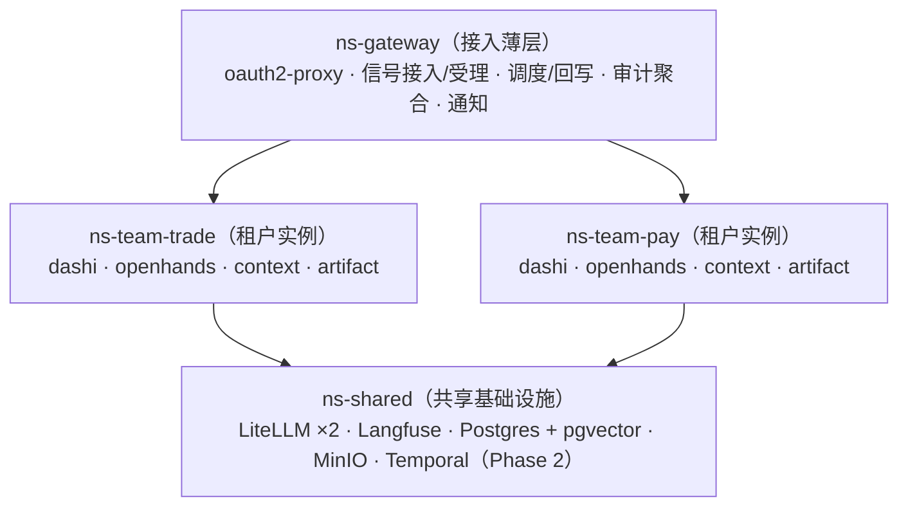

# Tandem 产品架构图

> 版本：v1.0（2026-10）
> 定位：以「**任务 = 唯一一等公民；上下文 = 一等服务；产物 = 支撑服务**」为约束，描述产品分层、核心域模型与部署边界。
> 设计原点：《00-项目定位》；产品边界：《01-产品方案》；实现细节：《02-技术设计》。
> 图表格式：Mermaid，GitHub / IDE 可直接渲染；不支持渲染时仍可按代码块阅读。

---

## 0. 读图约定

- 实线箭头：主调用或主数据流；
- 虚线箭头：事件、异步通知或派生视图；
- 橙色系（`core`）：一等服务 Context Service；
- 紫色系（`support`）：支撑服务 Artifact Service；
- 绿色系（`thin`）：接入与受理薄层；
- 所有任务状态只存在于任务源，上下文与产物服务不复制任务状态。

---

## 1. 架构总览

### 1.1 一句话

**一个公民（任务）、两个回路（任务回路 + 上下文回路）、三层边界（接入薄层 / 核心服务 / 执行与数据基础设施）。**

### 1.2 产品全景

### 1.3 分层架构

读法：自上而下是分层顺序，不代表严格调用链；越靠上越接近用户，越靠下越是基础设施。任务域只存权威状态，上下文与产物不复制任务状态；跨层协作见 §1.4，详细组件见 §2。

### 1.4 核心服务协作

读法：认领后先取上下文，再建会话；执行产出证据后登记产物并提议上下文；验收仍在任务域完成。

### 1.5 双回路

| 回路 | 路径 | 回答的问题 | 权威 |
|---|---|---|---|
| 任务回路 | 信号 → 任务 → 认领 → 执行 → 证据 → 验收 → 完成 | 这次交付是否成立 | 任务源 |
| 上下文回路 | 任务/会话/产物 → 提议 → 治理 → 存储 → 检索 → 注入 → 度量 | 下次交付是否更容易成立 | 上下文服务 |

咬合点：任务是上下文唯一的证据来源；上下文是任务的输入；验收结果是上下文质量的标签。

---

## 2. 分层职责

| 层 | 组成 | 职责 | 明确不做 |
|---|---|---|---|
| 交互层 | 项目面板、任务板、执行仪表、上下文健康、产物索引、IM | 状态投影、操作入口、对齐与排障 | 不承载权威状态，不自绘执行界面 |
| 接入与受理层 | SSO、信号适配器、去重/归一、Triage、通知 | 把原始信号变成合规任务；租户与身份入口 | 不建第二份任务数据，不替代人工受理 |
| 任务域 | 任务契约、DoR、认领租约、状态机、验收门 | 承载责任、验收、归因、计量 | 不执行任务，不管理 Agent 私有状态 |
| 执行域 | 调度/回写、OpenHands、ACP Agents、沙箱、证据采集 | 真正把活干了，回写可验证证据 | 不决定任务是否完成，不直推主干 |
| 上下文域 | 捕获、提议、治理、版本、检索、注入、度量 | 让同类任务越做越省；任务拉取型记忆 | 不承载任务状态，不自动写入，不驱动任务 |
| 产物域 | 登记、摘要、索引、引用、权限、保留 | 为上下文提供可检索、可引用的材料 | 不复制代码，不作为任务真源 |
| 治理与数据 | 审计、成本、预算、策略、Postgres/pgvector、对象存储、K8s | 可观测、可控制、可隔离、可恢复 | 不绕过任务与验收门 |

---

## 3. 核心域模型

| 实体 | 定位 | 关键不变量 |
|---|---|---|
| Signal | 原始输入 | 未受理前不是任务；去重可追溯 |
| Task | 唯一一等公民 | 有验收标准、责任人、成本与审计；`done` 只能由人置 |
| Claim | 任务租约 | 同一任务同时只有一条活动租约；可心跳、可超时释放 |
| Session | 执行实例 | 1 个任务 1..N 个会话；会话不承载任务状态 |
| ContextEntry | 受治理的上下文条目 | 有来源、版本、状态、有效期；默认待审，不自动注入 |
| ContextVersion | 条目版本 | 可追溯、可回滚；冲突可检测 |
| ContextUsage | 注入与引用记录 | 用于命中率、token 成本与复盘 |
| Artifact | 可引用材料 | 代码留在 Git；只登记 URI、摘要、索引与权限 |
| Project | 容器 | 上下文与策略边界；不维护第二套任务状态机 |
| User | 人 | 受理、执行、验收、治理的角色来源 |

---

## 4. 关键架构决策

| # | 决策 | 理由 | 代价 / 约束 |
|---|---|---|---|
| AD-01 | 任务是唯一一等公民 | 只有任务承载验收、责任、归因与账本 | 上下文不能替代任务成为主对象 |
| AD-02 | 上下文是一等服务 | 复利来自持续沉淀与任务级检索，不是全量遍历 | 需独立存储、治理、SLO 与度量 |
| AD-03 | 产物是支撑服务 | 为上下文供给可引用材料，不直接闭合复利回路 | 不复制代码，不建第二份文档真源 |
| AD-04 | 任务源唯一 | 避免双账本与状态漂移 | 薄层只做映射，不存任务主数据 |
| AD-05 | 人拥有完成权 | Agent 产出是概率性的，责任不可转移 | Agent 永远不能置 `done` |
| AD-06 | 证据优先于声明 | 关闭 Agent 自证循环 | 最小证据集不齐不得进入待验收 |
| AD-07 | Agent 可替换 | 不押注单一 Agent 厂商 | 归因、派发、回写必须协议化 |
| AD-08 | 上下文默认不自动入库 | 防止错误结论污染复利 | 提议 → 审批 → 版本化 → 可回滚 |
| AD-09 | 上下文按任务拉取 | 控制 token 成本，避免全量注入 | 检索质量与预算治理成为核心能力 |
| AD-10 | 租户 = 实例边界 | 用部署隔离替代代码级多租户 | 运维成本上升；存储按租户库/桶隔离 |
| AD-11 | PR-only | 保留可回退与可审计 | Agent 不得直推主干或 force push |

---

## 5. 部署架构

读法：网关层只做接入与编排；每个租户独立 namespace、PVC、库/Schema 与 Bucket 前缀；共享基础设施按租户配额隔离。组件资源基线见下表。

| 组件 | 资源基线 |
|---|---|
| dashi-taskboard（每租户） | 1C / 2G |
| OpenHands Canvas + Server（每租户） | 4C / 8G / 50G PVC（并发 3–5 会话） |
| Context Service（每租户） | 2C / 4G + 租户库配额 |
| Artifact Service（每租户） | 2C / 4G + Bucket 配额 |
| 共享组件（LiteLLM/Langfuse/PG/MinIO） | 合计约 16C / 32G，含 PG 2C / 8G / 100G 与对象存储 |

隔离：每租户独立 namespace 与 PVC；Postgres 与对象存储共享集群，但按租户独立库/Schema 与 Bucket 前缀隔离——共享的是存储资源，不是数据边界。

---

## 6. 演进边界

| 阶段 | 范围 | 不做什么 |
|---|---|---|
| Phase 1 | 信号受理、任务契约、认领执行、双门验收、上下文 v1、产物 v1 | 不做自动合并、自动完成、模型训练 |
| Phase 2 | Temporal 跨天流程、信任分级、上下文治理增强 | 不做组织级知识图谱 |
| Phase 3 | 跨项目上下文复用、评测闭环、容量与成本优化 | 不改变任务唯一权威源 |

---

## 7. 文档索引

- 业务定位与公理：`docs/00-项目定位-核心目标与一等公民.md`
- 产品边界：`docs/01-产品方案-Tandem人机协同研发平台.md`
- 架构与集成细节：`docs/02-技术设计-Tandem平台.md`
- 流程时序：`docs/06-流程时序图.md`
- 用户场景：`docs/03-用户场景故事-一次结算规则变更.md`
