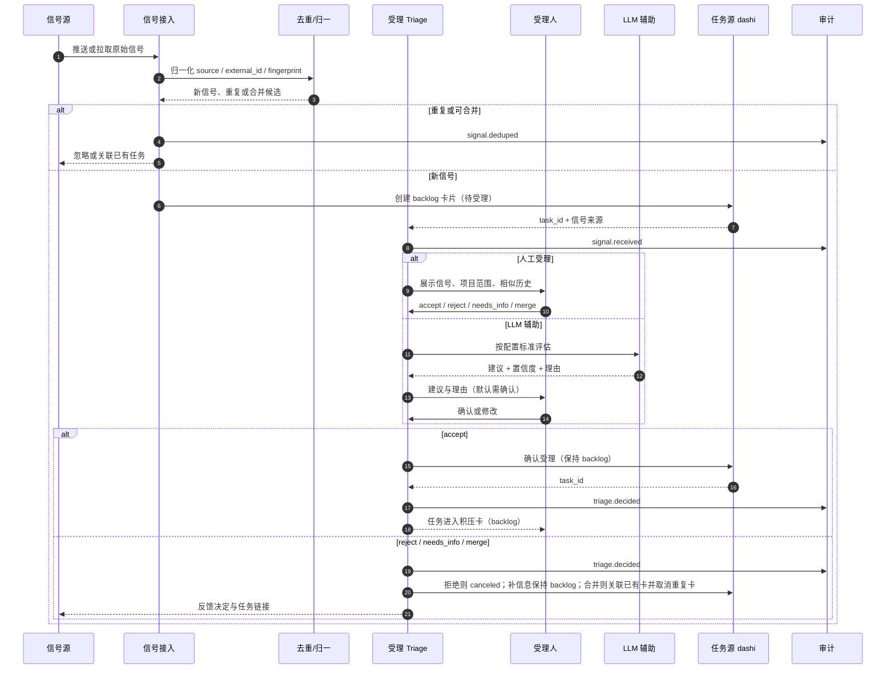
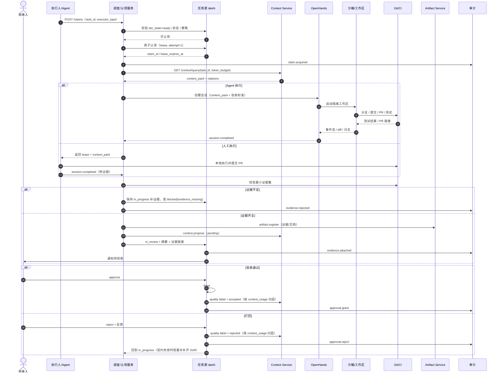
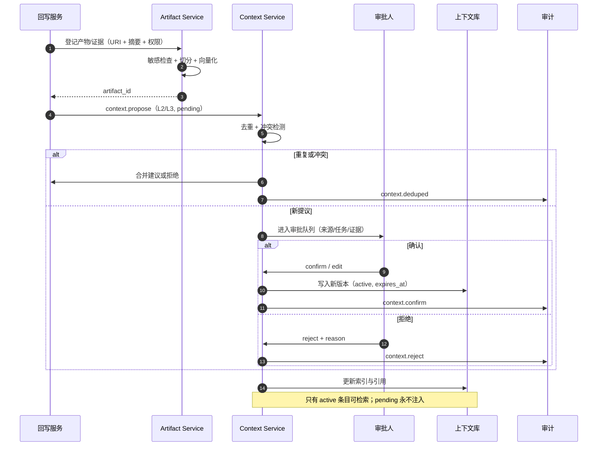
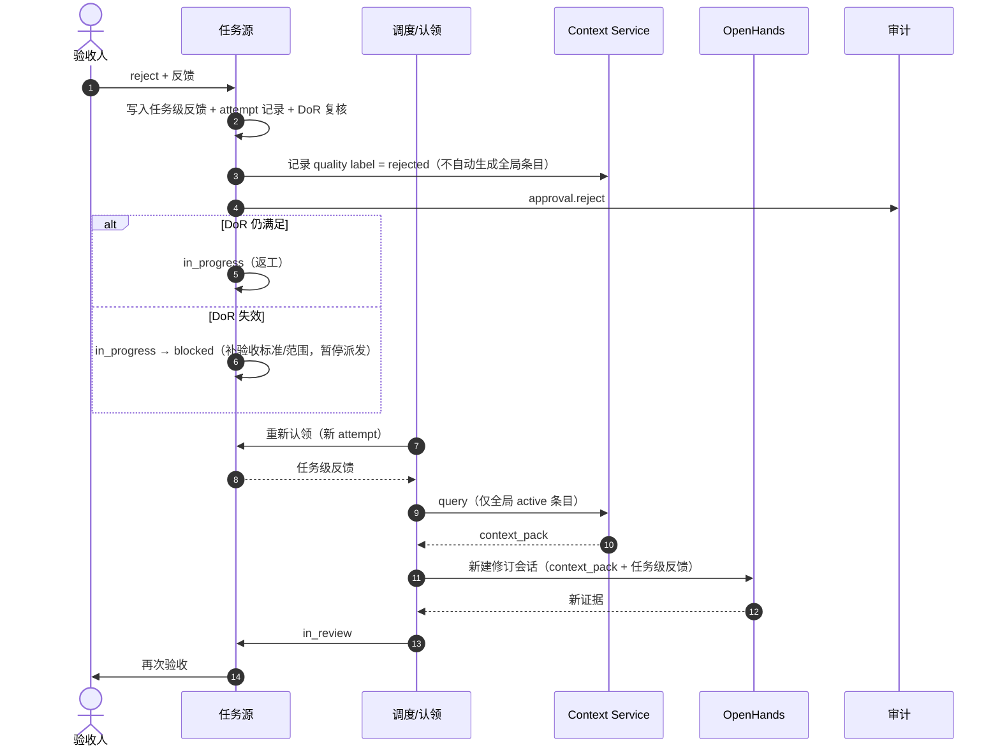
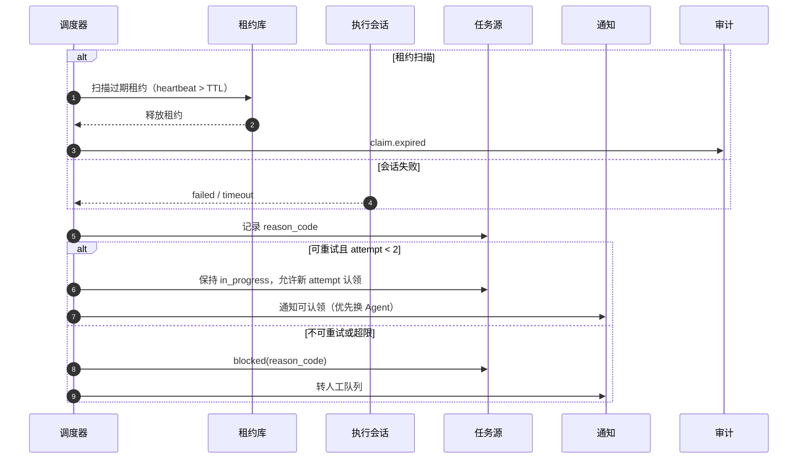
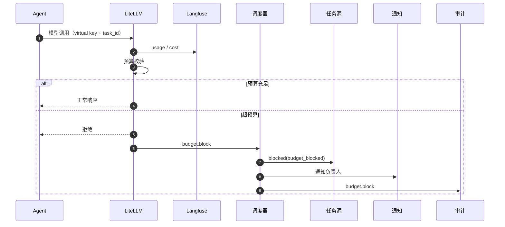
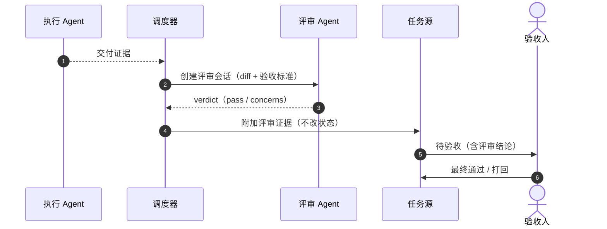

# Tandem 流程时序图

> 版本：v1.0（2026-10）
> 范围：Phase 1 核心流程的端到端时序，覆盖信号受理、任务执行、上下文治理、打回返工、异常重试、预算熔断与双 Agent 评审。
> 配套：`docs/05-产品架构图.md`（分层与域模型）、`docs/02-技术设计-Tandem平台.md`（实现细节）、`docs/03-用户场景故事-一次结算规则变更.md`（协同演练）。
> 图表格式：Mermaid `sequenceDiagram`，GitHub / IDE 可直接渲染。

---

## 0. 读图约定

- 所有时序均使用 `autonumber`，编号只用于阅读，不是接口序号；
- `alt / else` 表示分支，`opt` 表示可选步骤，`Note` 表示约束说明；
- 任务状态以任务源为准；上下文条目状态以 Context Service 为准；
- 图中“人”默认是具名责任人，不是抽象角色；Agent 不得代替人做验收或完成决定。

### 0.1 参与者

| 代号 | 参与者 | 职责 |
|---|---|---|
| 信号源 | Jira / IM / 邮件 / 监控 / 人工录入 | 产生原始信号 |
| 接入层 | 信号适配、去重、归一、Triage | 把信号变成候选任务 |
| 任务源 | dashi-taskboard | 唯一任务权威源、状态机、验收门 |
| 调度器 | 认领、租约、派发、回写 | 连接任务与执行面 |
| 执行人 / Agent | 人、OpenHands、ACP Agent | 实际执行并提交证据 |
| Context Service | 上下文服务（一等） | 捕获、治理、检索、注入、度量 |
| Artifact Service | 产物服务（支撑） | 登记、摘要、索引、引用 |
| 验收人 | 任务验收责任人 | 通过 / 打回，唯一完成权 |
| 审计 | 审计聚合 | 不可篡改记录关键事件 |
| 通知 | IM / 邮件 / 站内信 | 待办、超时、异常提醒 |

### 0.2 流程总览

| 编号 | 流程 | 触发 | 结束状态 |
|---|---|---|---|
| S1 | 信号受理与任务创建 | 新信号进入积压队列 | `backlog` |
| S2 | 任务认领、执行与验收 | 任务满足 DoR | `in_review` / `done` / `in_progress` / `blocked` |
| S3 | 上下文沉淀与治理 | 会话产出证据 | 条目 `active` 或 `rejected` |
| S4 | 打回与返工 | 验收不通过 | `in_progress` / `blocked` |
| S5 | 租约超时、失败与重试 | 心跳超时 / 会话失败 | `in_progress` / `blocked` |
| S6 | 预算熔断 | 任务成本超限 | `blocked(budget_blocked)` |
| S7 | 双 Agent 评审（可选） | 执行完成、需交叉审查 | 仍为 `in_review` |

---

## 1. S1 信号受理与任务创建

**前置条件**：信号已进入接入层；项目范围与受理标准已配置。
**后置条件**：新信号生成待受理的 `backlog` 卡片；受理、补充信息、拒绝或合并均在同一卡片留痕。

**关键规则**

1. 新信号去重后生成 `backlog` 积压卡，作为待受理记录；受理不另建第二张卡。
2. `backlog` 需受理并通过 DoR 才进入 `todo`；DoR 是准入字段，不新增 ready/draft 状态。
3. LLM 默认只给建议；低风险来源可在校准后自动受理，但必须保留 `reason` 与审计。
4. 受理 SLA 24h；超时进入升级队列，不允许无限期沉默。
5. 重复信号只做关联或合并，不重复建任务。

**异常分支**

| 场景 | 处理 |
|---|---|
| 重复信号 | 记录 `signal.deduped`，关联已有任务或忽略 |
| 信息不足 | 标记 `needs_info`，保持积压卡并请求来源补充 |
| 超出项目范围 | 拒绝并记录理由，可转其他项目 |
| LLM 置信度低 | 强制人工确认，不自动受理 |
| 任务源不可用 | 信号留在积压队列，重试；不双写其他任务源 |

---

## 2. S2 任务认领、执行与验收

**前置条件**：任务为 `todo`，DoR 通过，预算与容量可用。
**后置条件**：证据齐全则 `in_review`，人验收后 `done` 或打回；证据不足则保持 `in_progress` 补齐，或进入 `blocked`。

**关键规则**

1. 首次认领仅允许 `todo`；返工或重试允许无活动租约的 `in_progress` 且 DoR 仍满足；认领必须是原子操作，同一任务同时只有一条活动租约。
2. 先认领、后检索：`context.query` 必须带 `task_id` 与 token 预算，返回条目必须带引用。
3. `context_pack` 只包含 `active` 条目；`pending` 提议永不注入。
4. Agent 不得置 `done`、不得直推主干、不得 force push；只提交 PR 与证据。
5. 证据最小集不齐，不得进入 `in_review`；验收通过后由人关闭任务。
6. 验收结果回写上下文质量标签，供后续检索排序与治理。

**异常分支**

| 场景 | 处理 |
|---|---|
| 重复认领 | 租约 CAS 失败，返回 409；不产生第二个执行会话 |
| 上下文检索超时 | 默认降级为空 pack 并标记 `context_degraded`；高敏项目可配置阻断 |
| 上下文为空 | 允许执行，但标记 `context_miss`，用于后续补条目 |
| 会话失败 | 走 S5 失败/重试；不直接判任务失败 |
| 证据缺失 | 保持 `in_progress` 补证据，或进入 `blocked(evidence_missing)` |
| 验收人不在 | 任务保持 `in_review`，通知升级；不得自动通过 |

---

## 3. S3 上下文沉淀与治理

**前置条件**：任务已产出证据或可复用结论；提议人已完成来源标注。
**后置条件**：条目进入 `active` 或 `rejected`；只有 `active` 可被检索。

**关键规则**

1. L1 稳定层、L2 决策层、L3 经验层、L4 产物层分权治理；L3 默认人工确认。
2. 任何 Agent 提议默认 `pending`；不得自动进入 `active`。
3. 失败任务的结论不得进入 L1/L2；只可作为 L3 待审提议，并标注失败上下文。
4. 条目必须有来源、负责人、有效期、版本；支持过期、回滚、冲突检测。
5. 产物服务只登记 URI、摘要、索引与权限；代码正文留在 Git，不复制。
6. 上下文按租户/项目隔离；跨项目复用必须显式授权。

**异常分支**

| 场景 | 处理 |
|---|---|
| 提议重复 | 合并到已有条目，保留来源链接 |
| 与现有条目冲突 | 标记冲突，进入人工裁决；不覆盖旧版本 |
| 审批超时 | 条目保持 `pending`；不阻塞任务完成，但计入治理积压 |
| 来源任务被删除 | 条目降级或失效，保留审计链 |
| 敏感信息 | 阻断入库；进入安全评审，不进入检索索引 |

---

## 4. S4 打回与返工

**前置条件**：任务处于 `in_review`，验收人给出明确打回理由。
**后置条件**：任务回到 `in_progress`；返工产生新会话与新证据。

**关键规则**

1. 每次返工必须新建会话，不复用旧会话；旧证据保留，不覆盖。
2. 打回反馈保存在任务源/会话记录，不自动升级为全局条目；如需沉淀，走 S3 审批。
3. 返工计入 `attempt` 与成本；超过上限转人工或拆分任务。
4. 打回必须给理由码与可操作反馈，否则验收操作无效。
5. DoR 失效时先补契约，不带着模糊标准反复返工。

**异常分支**

| 场景 | 处理 |
|---|---|
| 反馈为空 | 拒绝该次打回操作，要求填写理由码 |
| 连续返工超限 | 转人工处理或拆分为子任务，不无限重试 |
| 旧会话仍有租约 | 先释放旧租约，再创建新会话 |
| 任务范围变化 | 转为 `blocked` 重新复核 DoR，补齐后回 `in_progress`；范围独立时拆分新积压卡 |

---

## 5. S5 租约超时、失败与重试

**前置条件**：任务处于 `in_progress`，存在活动租约或执行会话。
**后置条件**：可重试则保持 `in_progress` 并释放租约；不可重试则 `blocked`。

**关键规则**

1. 租约必须有 TTL 与心跳；超时自动释放，避免任务被永久占用。
2. 重试上限默认 2 次；每次重试优先换执行者，避免同一 Agent 重复失败。
3. 失败必须记录 `reason_code`，不允许只写“失败”两个字。
4. 不可重试错误直接 `blocked`，转人工；不得静默丢弃。
5. 租约释放与重新认领必须幂等，避免并发重复执行。

**异常分支**

| 场景 | 处理 |
|---|---|
| 心跳丢失但会话仍在跑 | 先标记租约过期，再终止/回收会话，防止双写 |
| 执行者主动放弃 | 释放租约，保持 `in_progress` 等待重新认领，记录 `abandoned` |
| 连续失败 | `blocked`，通知项目负责人；必要时拆分任务 |
| 任务源不可用 | 本地记录待回写，恢复后幂等补写 |

---

## 6. S6 预算熔断

**前置条件**：任务已配置预算；模型调用经 LiteLLM 携带 `tenant_id` / `task_id`。
**后置条件**：预算充足则继续；超限则阻断调用并将任务置为 `blocked`。

**关键规则**

1. 预算按租户、项目、任务三级配置；硬上限优先于软提醒。
2. 超限先阻断模型调用，不等待会话自然结束。
3. 任务进入 `blocked(budget_blocked)` 后，只有人能追加预算或关闭任务。
4. 成本数据以 LiteLLM / Langfuse 为准；任务账本只做汇总，不重复计费。
5. 熔断事件必须可追溯到具体任务、会话与模型。

---

## 7. S7 双 Agent 评审（可选）

**前置条件**：任务执行完成，项目启用交叉评审；评审 Agent 与执行 Agent 不同。
**后置条件**：评审结论作为证据附加，任务仍由人验收。

**关键规则**

1. 评审 Agent 只给意见，不改变任务状态，不替代人验收。
2. 评审结论必须附理由与引用；`concerns` 要能定位到具体文件/行/验收项。
3. 评审会话与执行会话分离，避免同一 Agent 自证。
4. 评审成本计入任务账本；评审不通过不自动触发返工，由人决定。

---

## 8. 状态与事件对照

| 时点 | 任务状态 | 上下文状态 | 关键事件 | 责任方 |
|---|---|---|---|---|
| 收到信号 | 无（积压队列） | — | `signal.received` | 接入层 |
| 信号建卡 | `backlog` | — | `task.created` | 接入层 |
| 受理通过 | `backlog` | — | `triage.decided` | 受理人 |
| DoR 通过 | `todo` | — | `task.ready` | 任务源 |
| 认领成功 | `in_progress` | — | `claim.acquired` | 调度器 |
| 上下文注入 | `in_progress` | `active` 条目被引用 | `context.injected` | Context Service |
| 证据齐全 | `in_review` | 提议 `pending` | `evidence.attached` | 调度器 / 执行者 |
| 验收通过 | `done` | 质量标签 `accepted` | `approval.grant` | 验收人 |
| 验收打回 | `in_progress` | 质量标签 `rejected` | `approval.reject` | 验收人 |
| 执行失败 | `in_progress` / `blocked` | — | `session.failed` | 调度器 |
| 预算超限 | `blocked` | — | `budget.block` | LiteLLM / 调度器 |
| 上下文确认 | — | `active` | `context.confirm` | 审批人 |
| 上下文拒绝 | — | `rejected` | `context.reject` | 审批人 |

---

## 9. 幂等与异常处理总表

| 风险点 | 机制 | 失败时行为 |
|---|---|---|
| 重复信号 | `source + external_id + fingerprint` 唯一约束 | 关联或忽略，不重复建任务 |
| 重复认领 | 租约 CAS / 状态机版本号 | 返回 409，不启动第二个会话 |
| 重复回写 | `session_id + evidence_hash` 幂等键 | 已存在则返回原结果 |
| 上下文重复提议 | 相似度 + 来源去重 | 合并或拒绝，不覆盖 |
| 审批重复提交 | `task_id + version + decision` 幂等 | 旧版本审批失效，返回冲突 |
| 上下文检索超时 | 超时 + 降级策略 | 默认空 pack + `context_degraded`；高敏项目可阻断 |
| 产物登记失败 | 重试队列 + 指数退避 | 超过阈值 `blocked(artifact_unavailable)` |
| 任务源不可用 | 本地事件表 + 恢复后补写 | 不双写第二任务源 |
| Agent 越权 | 权限矩阵 + PR-only + 禁止 `done` | 拒绝操作并审计 |

---

## 10. 关联文档

- 架构与分层：`docs/05-产品架构图.md`
- 架构与集成细节：`docs/02-技术设计-Tandem平台.md`
- 产品边界与受理规则：`docs/01-产品方案-Tandem人机协同研发平台.md`
- 协同演练：`docs/03-用户场景故事-一次结算规则变更.md`
