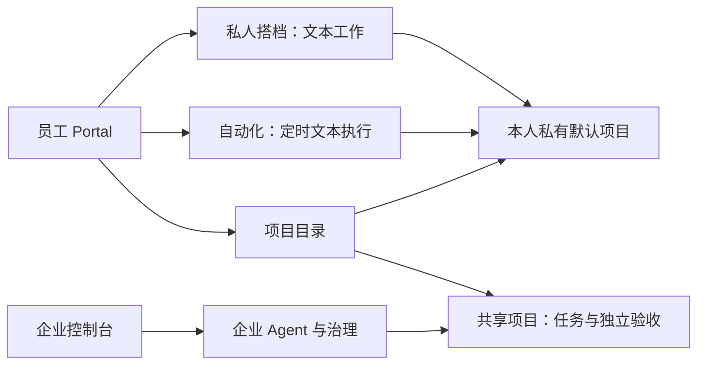

# WorkAgent

面向中小企业的 AI 工作平台：为员工提供私人文本搭档，把团队交付放进可追踪的项目任务，并以审批、独立验收和权限隔离保留人的责任。

适合希望将日常文本工作、定时整理与团队任务分开管理的业务员工、项目负责人和企业管理员。当前是持续开发中的独立产品；有运行后端与回归测试，但尚无可据此宣称生产可用的目标环境验收。

## 产品形态

| 入口 | 当前范围 |
| --- | --- |
| 个人 Portal | 私人搭档档案、文本执行、自动化、项目、本人授权与消耗 |
| 企业控制台 `/tenant` | Agent 构建、知识/技能/连接器、成员、渠道、审计与配额等治理页面 |
| 平台控制台 `/super-admin` | 独立登录、创建企业与新负责人、聚合运营信息、名称/套餐配置 |

两个前端共享模块化后端。企业和平台控制台是独立权限壳，并不意味着完整企业管理或 SaaS 生命周期已交付。平台权限不来自企业管理员身份。



任务协作只有「自动化」与「项目」两个入口。每位用户拥有真实、不可共享的默认项目，展示本人未归属执行；这只是授权展示上下文，不改写执行历史的项目归属。没有独立个人执行历史列表。

个人搭档及其自动化仅处理文本，不接工具、知识库、个人记忆或 IM 投递。企业 Agent 的工具、知识和渠道能力另行配置；保存配置不代表供应商已经连通。项目任务是持久工作记录，Agent 是可选执行者，执行成功不等于任务验收。

详见 [产品介绍与洞察](docs/product.md) 和 [交互指南](docs/product-experience.md)。

## 本地开发

需要 Node.js **22+**、**pnpm 11.4.0**、Docker（或已有 PostgreSQL **16 + pgvector**）。以下命令在本目录运行：

```sh
cp .env.example .env
pnpm install --frozen-lockfile
docker compose -f infra/compose/docker-compose.yml up -d postgres
# 等待数据库健康；已有数据库则先调整 .env 的 DATABASE_URL
pnpm db:migrate
pnpm db:seed
pnpm dev
```

按 `.env.example` 设置本地登录信息和模型环境变量；本页不提供账号或密码。seed 仅供开发，会重设配置的开发管理员密码，并创建演示资源；演示连接器不是可用的业务系统。生产禁止 seed。真实模型执行需要 `MODEL_API_KEY`，缺失时失败，不自动使用假模型。人工项目任务不要求模型可用。

| 应用 | 地址/端口 | 职责 |
| --- | --- | --- |
| user-portal | http://localhost:5174 | 员工 Portal |
| console | http://localhost:5173 | 企业与平台控制台 |
| api | 4100 | API、会话、授权、SSE |
| channel | 4101 | 渠道入站 |
| worker | 无网页端口 | 执行、调度、入库和后台任务 |

`pnpm dev:user-portal`、`pnpm dev:console` 可单独启动前端；占用端口直接报错。前端将 `/v1` 代理至 API。环境仅自动读取本目录 `.env`；`ENV_FILE` 可显式选文件，进程环境优先。

开发 seed 不授予平台权限。平台需用新身份单独执行 `pnpm production:provision platform EMAIL`，密码由标准输入或专用环境变量提供；详见 [账号初始化与部署](docs/operations.md)。

## 目录与验证

- `apps/`：两个前端、API、worker、channel。
- `packages/`：core、contracts、db、config、ui；数据库演进在 `packages/db/migrations/`。
- `tests/`：浏览器回归与固定测试输入；`scripts/`：验证、初始化、备份恢复等工具。
- `infra/`：容器与反向代理配置；`docs/`：长期产品和工程事实。

```sh
pnpm typecheck
pnpm build
# 先按测试手册配置隔离 TEST_DATABASE_URL
pnpm test
```

[架构](docs/architecture.md) · [测试](docs/testing.md) · [运维与发布门槛](docs/operations.md) · [设计决策](docs/decisions.md)

build 检查共享包并构建两个前端；后端通过 tsx 运行 TypeScript 源码。仓库包含 CI 配置，不代表托管 CI 已通过，也不代表已部署。当前未声明开源许可证，公开源码不自动授予使用或分发许可。
