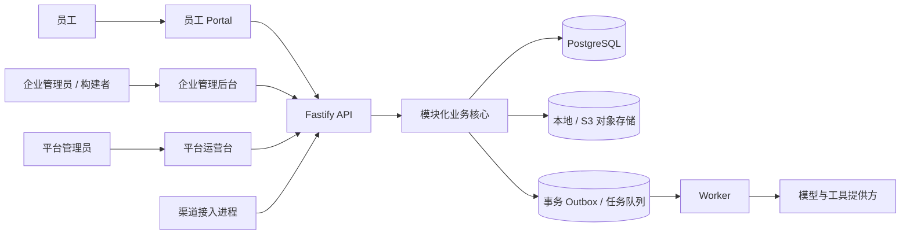
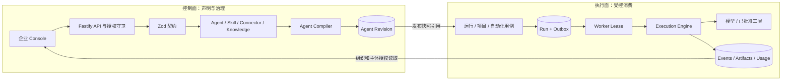
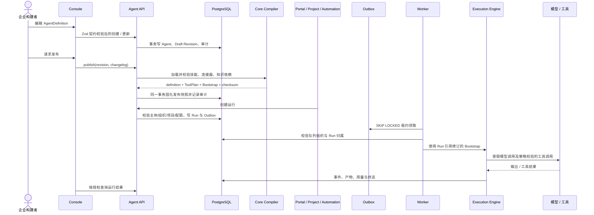
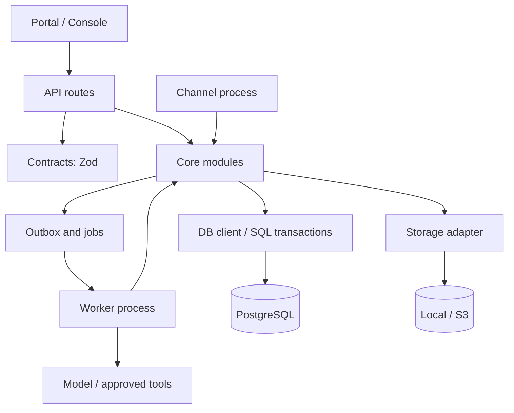
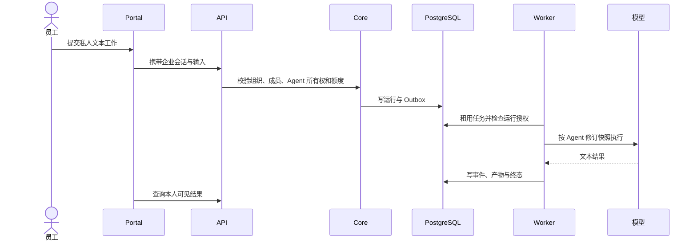

# 系统架构

本文记录 WorkAgent 当前代码和数据库能够证明的架构事实。管理菜单或规划目录中的页面，不等同于已交付的服务端能力。

## 产品边界

WorkAgent 有三个浏览器入口：员工 Portal、企业管理后台和平台运营台。Portal 使用企业成员会话，企业后台使用同一企业身份但受管理权限约束；平台运营台使用独立的平台身份、授权和会话。三者调用同一模块化 API，不代表彼此共享资源授权。

Portal 当前顶栏提供档案、成长、记忆、技能、知识、自动化、项目、授权、设备和消耗十个入口。对话和内容详情仍有页面路由，但不在顶栏。企业和平台后台的菜单由路由清单生成；页面壳可展示通用资源表单，但只有存在对应服务端契约且完成授权、持久化和测试的操作才算交付。

## Agent 归属模型

当前实现有两类 Agent 资源：

| 类型 | 数据归属 | 使用边界 | 当前能力 |
| --- | --- | --- | --- |
| 个人 Agent（Portal 私人搭档） | `agent.org_id` 与 `agent.personal_owner_id`；每个企业成员至多一个，所有者不可变 | 私有可见；只能由本人读取、编辑和执行；不能被企业管理员读取绕过，也不能指派给项目任务或接入企业渠道 | 受限文本执行；个人技能、知识和确认记忆由本人维护并编译进私人指令版本；自动化由本人拥有 |
| 企业 Agent（管理后台构建的 Agent） | `agent.org_id`、`created_by` 和 `visibility`；没有个人所有者 | 组织可见性和企业授权决定管理访问；项目任务还要求执行者具有项目成员资格；渠道绑定只能引用企业 Agent | 版本化构建与发布、技能/连接器/知识依赖、评测和企业执行策略 |

数据库和 API 没有部门表、部门成员关系、`department_id`、部门授权范围或部门 Agent 生命周期。因此，企业 Agent 不是“部门 Agent”的同义词，也没有按部门隔离或自动继承部门成员权限的语义。若产品需要部门 Agent，需另行定义部门身份关系、成员同步、资源所有权、授权变化和迁移方案；当前不能通过 Agent 名称或 `visibility='org'` 推导部门归属。

个人 Agent 的数据库约束和运行时检查共同维护所有权：迁移 `012_personal_assistant.sql` 增加不可变所有者与每人唯一索引；个人 API 使用当前已认证的企业成员身份查询和保存；执行、运行记录、自动化和工人调度再次校验组织、所有者及有效成员状态。私人指令编译采用独立的文本受限策略，不挂企业工具、连接器、知识空间或项目。

企业 Agent 与个人 Agent 共用 `agent` / `agent_revision` 的基础存储，但以 `personal_owner_id IS NULL` 划分企业构建边界。企业 Agent 的已发布修订形成不可变运行快照。项目任务可选择已发布企业 Agent；Agent 运行只是任务尝试，运行成功不代表任务已验收。项目成员授权不会扩大到私人 Agent。

## 技术组成

| 组件 | 实现 | 职责 |
| --- | --- | --- |
| Portal / Console | React 19、TypeScript、Vite、React Router、TanStack Query | 两个独立前端应用；跨应用复用只能通过 workspace packages |
| API | Fastify、Zod、Cookie 会话 | HTTP 边界、认证、契约校验、授权入口与业务用例调用 |
| Contracts | Zod schemas | 请求、响应和领域数据边界；共享于 API、Core 与前端 |
| Core | TypeScript 模块化单体 | Agent、执行、项目、自动化、授权、队列、渠道、审计和存储用例 |
| Database | PostgreSQL 16、pgvector | 事务事实源；迁移按顺序追加，不重写已发布迁移 |
| Worker | 独立 Node 进程 | 领取 outbox 任务，运行模型调用、调度和后台处理 |
| Channel | 独立 Node 进程 | 接收带签名的外部渠道事件并转交 API 处理 |
| Object storage | 本地开发存储或 S3 | 上传文件与运行产物；下载仍受组织、用户或显式项目授权控制 |

代码组织目前是共享 Core 与 DB 包的模块化单体，不是每个领域独立部署的微服务，也未完整采用按领域分目录的 Domain/Application/Infrastructure 三层模板。API route 调用 Core 用例，部分 Core 模块仍直接执行 SQL；重构应以实际聚合和事务边界为单位，不应把目标态分层写成现状。

## 控制面与执行面

控制面负责身份、租户资源、声明配置和治理决策；执行面负责消费已授权的不可变修订并产生运行事实。两者共享 PostgreSQL 和 Core 包，但通过修订/快照、运行记录及 Outbox 任务划定职责，不以独立微服务或网络边界作为隔离手段。

共享数据库不会自动授予跨面访问权限：控制面读取和变更先验证当前主体、组织及构建权限；执行面创建运行时绑定组织、用户、Agent 修订及项目来源。Worker 领取任务后再次验证任务组织和运行授权。Console 的可见按钮只用于交互，不是授权边界。

## Agent 构建、发布与运行时序

创建或更新只产生可变的 Draft 声明，不生成运行快照。发布时，`compileAgent` 从组织内加载启用依赖、规范化工具计划、构造系统指令并计算稳定 checksum；API 将定义、工具计划和 bootstrap 写入同一发布修订，并更新 Agent 当前发布版本。生产环境发布还要求该 checksum 对应的全通过评测，或由 owner/admin 提供并审计覆盖理由。

运行创建把运行记录和 `run.execute` Outbox 事件放在事务边界内。Worker 通过租约、心跳、重试退避和 fencing 字段处理并发及崩溃恢复，再把运行交给引擎。引擎读取运行绑定的修订快照，不重新读取 Agent 当前草稿；因此发布新版本不会改变已排队或已开始运行的执行定义。工具副作用仍受审批、超时、重放账本和出站网络策略控制。

## 三类契约与状态边界

| 契约 | 事实来源 | 可变性与用途 | 不应承担的职责 |
| --- | --- | --- | --- |
| 声明契约 `AgentDefinition` | `packages/contracts/src/agent.ts` 的 Zod schema | Draft 表单与创建/更新请求；定义模型参数、指令、限制、技能/连接器/知识引用、审批、记忆、输出和可见性 | 不等于已经验证的资源集合；不可由前端声明替代服务端权限检查 |
| 编译契约 `RuntimeBootstrapSnapshot` + `ToolPlan` | `packages/core/src/compiler.ts` 与发布后的 `agent_revision.bootstrap` | 对一次 Agent 修订固化编译结果、依赖解析结果、运行指令和 checksum | 发布后不随资源名称、草稿或当前 Agent 指针变化；不保存运行过程状态 |
| 执行契约 `agent_run`、事件、检查点、审批与产物 | `packages/core/src/runs.ts`、`engine.ts` 与数据库迁移 | 表达一次有主体和组织归属的运行尝试、状态迁移及其证据 | 不回写定义或修订；项目任务验收也不由运行成功自动替代 |

边界检查应覆盖契约 schema、修订快照 checksum、跨组织依赖拒绝、未授权运行拒绝、发布后修订不可变、队列重复/失租恢复，以及运行成功与项目验收分离。产品页面只可声称已经由真实 API、授权、持久化和相应测试覆盖的能力。

## 关键数据与业务流

- 认证身份由服务端会话解析；资源查询必须绑定组织和当前主体。平台会话使用独立 Cookie 与 live platform grant，不能作为企业成员会话使用。
- Agent 发布快照、执行记录、队列任务、项目任务、个人自动化和审计均由 PostgreSQL 事务及约束保护。异步工作由 outbox、租约、心跳和带 fencing 的确认流程处理。
- 项目任务是规划记录，`agent_run` 是实际执行记录；任务尝试关联二者。项目资源要求显式项目成员授权，私人执行保留个人归属，不因默认项目的展示上下文改写来源。
- 工具出站限定 HTTPS 主机并在连接时检查 DNS 与重定向；密钥加密保存。供应商产生的不确定副作用不会被描述为绝对 exactly-once。
- 企业渠道要求签名、重放防护和已绑定身份。个人 Agent 不进入企业渠道路由。

## 模块边界与验证

主要业务模块位于 `packages/core/src/`，契约位于 `packages/contracts/src/`，迁移位于 `packages/db/migrations/`，HTTP 入口位于 `apps/api/src/routes/`。`apps/console/src/admin/page-catalog.ts` 是管理页面描述目录；它列出的 URL 只有在 API 存在真实路由并经过集成验证后才具备服务能力。当前该目录包含部分未接通后端的占位页面，不能用目录存在证明操作已落地。

新业务边界应先定义所有者、授权谓词、状态迁移和事务约束，再通过契约测试、Core/API 测试和隔离 PostgreSQL 测试实现；跨模块调用应显式表达，不共享未授权的数据访问。项目测试和数据库要求见 [测试手册](testing.md)，发布与恢复要求见 [运维手册](operations.md)，个人自动化语义见 [自动化说明](personal-automation.md)。
